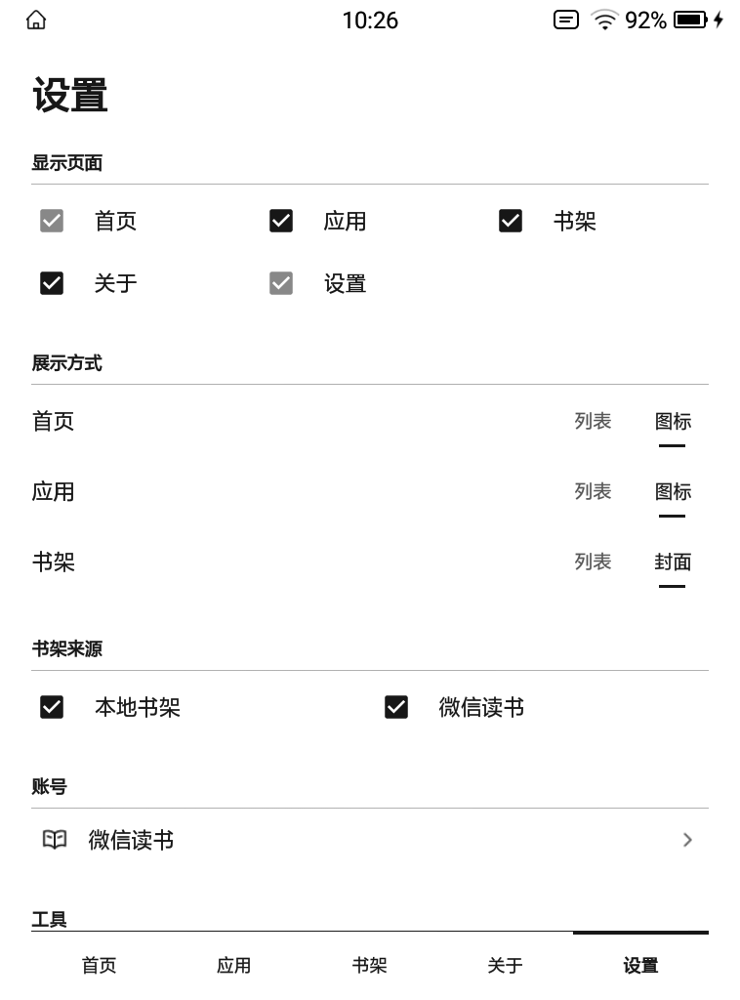

# Ginkgo

An e-ink launcher for the first-generation Xiaomi MiReader. Open your apps and books from one place; keep reading in Duokan or WeRead.

[Screenshots](#screenshots) · [Installation](#installation)

   
  <em>Ginkgo on the first-generation Xiaomi MiReader.</em>

## Screenshots

More screens and the exported wallpaper

<table>
  <tr>
    <td align="center">
       Apps
    </td>
    <td align="center">
       Bookshelf
    </td>
    <td align="center">
       About
    </td>
    <td align="center">
       Settings
    </td>
    <td align="center">
       Cover wallpaper
    </td>
  </tr>
</table>

## Installation

Tested on the first-generation Xiaomi MiReader (Android 8.1). Install the Ginkgo APK, then select Ginkgo when prompted to choose a launcher.

---

Made by Locusable Studio.
