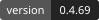
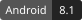
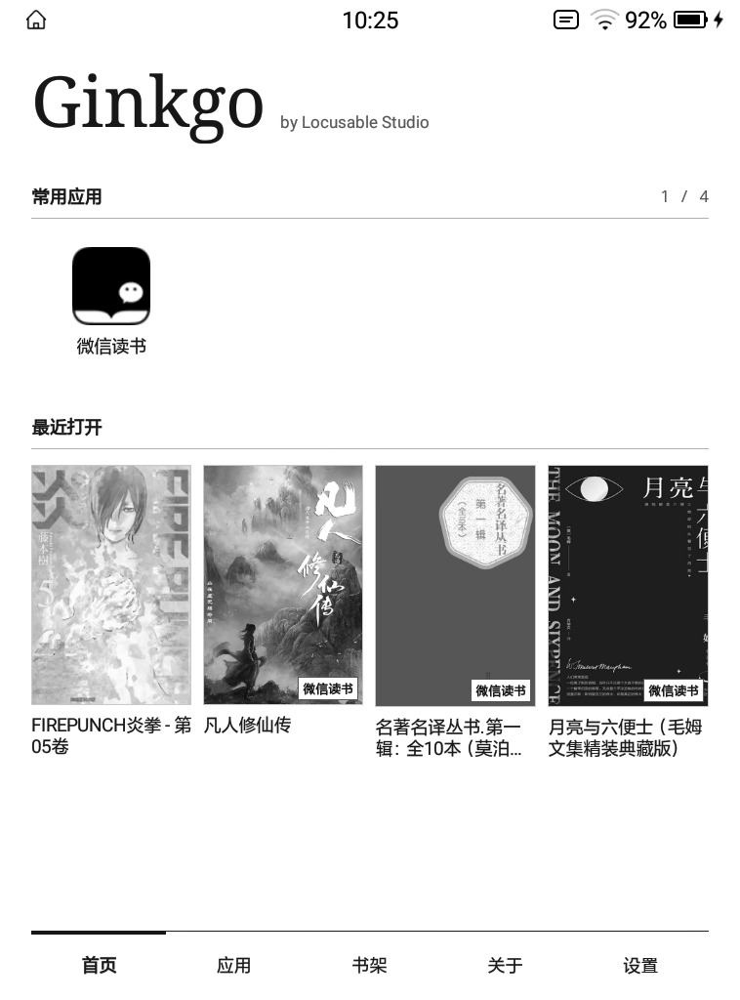
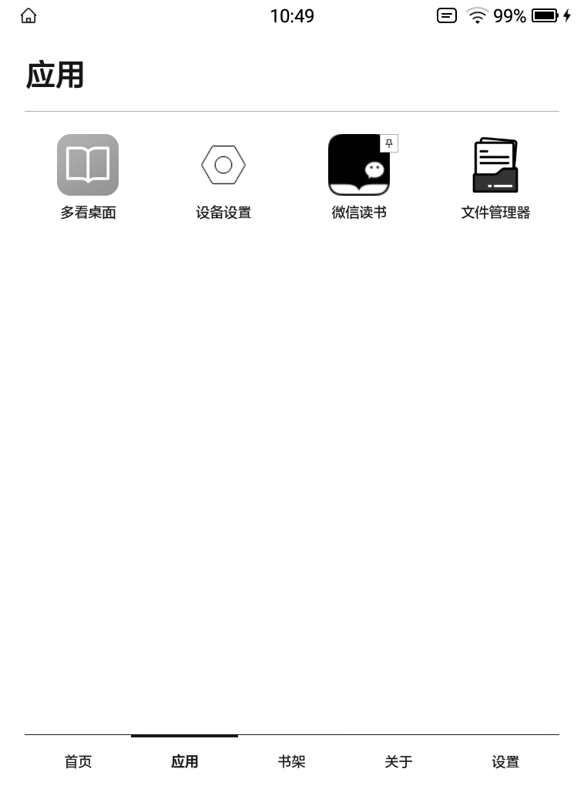
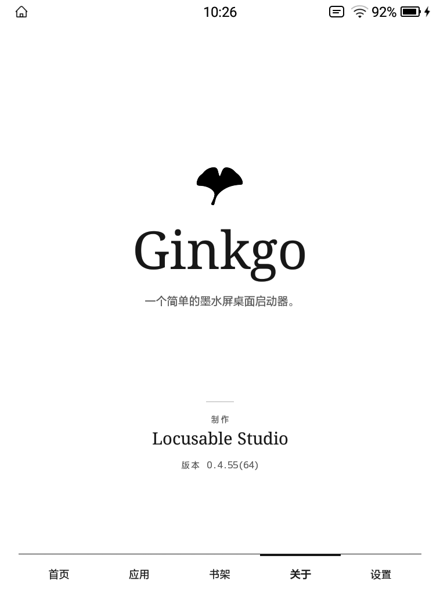

# Ginkgo

An e-ink launcher for the first-generation Xiaomi MiReader (Android 8.1).

[**Download Ginkgo 0.4.56 (APK)**](https://github.com/locusable-studio/Ginkgo/releases/download/v0.4.56/Ginkgo-0.4.56.apk) · [Latest release](https://github.com/locusable-studio/Ginkgo/releases/latest)

## Screenshots

<table>
  <tr>
    <td align="center"> Home</td>
    <td align="center"> Apps</td>
    <td align="center"> Bookshelf</td>
  </tr>
  <tr>
    <td align="center"> Settings</td>
    <td align="center"> About</td>
    <td align="center"> Cover wallpaper</td>
  </tr>
</table>

## Bookshelf

Ginkgo brings local and WeRead books into one shelf. Tapping a book opens the original reading app via a deep link; Ginkgo does not import or display the book itself.

- **Duokan:** Ginkgo shows books from `Books/` and passes only the book ID to Duokan. After copying new books, open **Duokan Desktop → Bookshelf** to refresh the shelf. Ginkgo may list a new book before Duokan indexes it, but its deep link will not work until the book is indexed.
- **WeRead:** Sign in under **Settings → Account → WeRead** in Ginkgo to sync your shelf. Sign in separately in the **WeRead e-ink app** to read. Signing in to one does not sign you in to the other.

## Installation

Install the Ginkgo APK, then select Ginkgo when prompted to choose a launcher.

---

Made by Locusable Studio.
